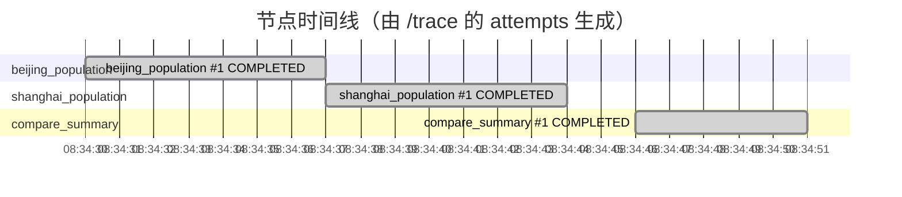

# /cost 与 /trace 演示素材

> 数据来自 `python3 scripts/demo/capture_cost_trace.py` 真实跑出来的一条 workflow（模型：`deepseek-v4-flash`）。
> 抓取时间：2026-10-10 08:34 UTC

## 1. 这条 workflow

- 目标：分别查一下北京和上海的人口，然后写一段对比总结
- workflow_id：`4a1367da-b412-46d3-b97c-aae209c04c04`
- 状态：**COMPLETED**，总耗时 `21559 ms`
- DAG 节点：beijing_population, shanghai_population, compare_summary

## 2. `GET /workflows/{id}/cost` —— 花了多少钱

```json
{
  "workflow_id": "4a1367da-b412-46d3-b97c-aae209c04c04",
  "model": "deepseek-v4-flash",
  "budget_usd": 0.05,
  "input_tokens": 6093,
  "output_tokens": 3407,
  "cost_usd": 0.005393
}
```

- 预算 $0.05，实际 $0.005393（10.8% 用掉）
- token：6093 输入 + 3407 输出

## 3. `GET /workflows/{id}/trace` —— 时间花在哪一步

```json
{
  "workflow_id": "4a1367da-b412-46d3-b97c-aae209c04c04",
  "status": "COMPLETED",
  "duration_ms": 21559,
  "critical_path": [
    "shanghai_population",
    "compare_summary"
  ],
  "critical_path_ms": 12856,
  "slowest_node": {
    "node_id": "shanghai_population",
    "attempts": 1,
    "status": "COMPLETED",
    "duration_ms": 7493,
    "llm_ms": 7383,
    "steps": 3,
    "input_tokens": 2293,
    "output_tokens": 1308,
    "cost_usd": 0.002058
  },
  "most_tokens_node": {
    "node_id": "shanghai_population",
    "attempts": 1,
    "status": "COMPLETED",
    "duration_ms": 7493,
    "llm_ms": 7383,
    "steps": 3,
    "input_tokens": 2293,
    "output_tokens": 1308,
    "cost_usd": 0.002058
  }
}
```

### 每个节点的分项

| 节点 | 尝试次数 | 状态 | duration_ms | llm_ms | steps | token（入 + 出） | 成本 |
| --- | --- | --- | --- | --- | --- | --- | --- |
| beijing_population | 1 | COMPLETED | 7356 | 7230 | 3 | 2218 + 1074 | $0.001780 |
| shanghai_population | 1 | COMPLETED | 7493 | 7383 | 3 | 2293 + 1308 | $0.002058 |
| compare_summary | 1 | COMPLETED | 5363 | 5316 | 1 | 1582 + 1025 | $0.001555 |

### 关键结论

- 关键路径 `shanghai_population → compare_summary`，12856 ms；总耗时 21559 ms。
- 最慢节点 `shanghai_population`：7493 ms 里 7383 ms 是模型延迟（**98.5%**）——
  这正是把 `llm_ms` 和 `duration_ms` 分开记账的意义：慢在模型还是慢在工具，一眼能看出来。
- 成本最大的节点：`shanghai_population`。


